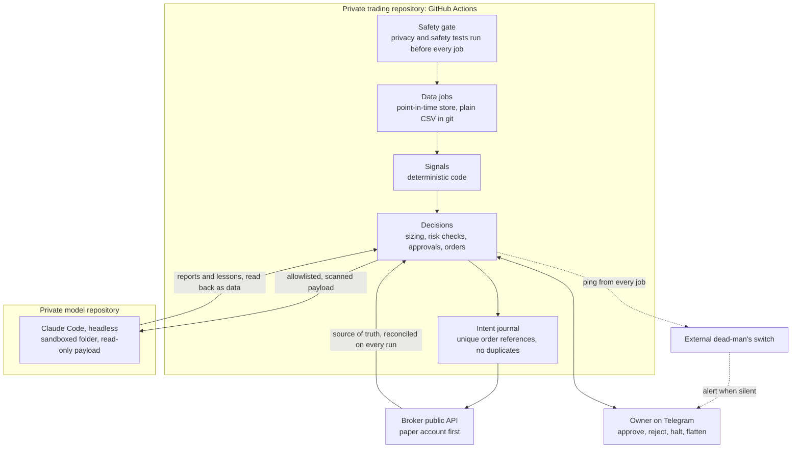

# Quant Agent

Quant Agent is a personal project that picks shares in large US companies for a long-term investment account,
following fixed rules written in code. AI helps by writing reports, checking results and teaching, but it never
trades: every buy and sell is decided by tested code, and the owner can stop everything at any moment.

A personal, long-only US stock-selection system, built test-first, in which deterministic code makes every
decision and Claude models only advise, review and teach. No model can place an order, change a limit, or grade its
own work.

This repository shows the architecture, the safety design and the tech stack. The strategy itself, its settings,
its data and its results live in a private repository and never appear here; the checks described at the end
enforce that.

## Status

The system is still being built. This page describes the approved design; each part ships only with its tests.

<!-- test-count: written by GitHub Actions in the private repository; do not edit -->
**Tests:** 972 automated tests pass in the private repository, counted by its GitHub Actions run.

**Built and tested**

- Safety plumbing: secret-blocking hooks, a safety gate that runs before every job, continuous integration, and the
  single trading queue, proven on real GitHub.
- A read-only broker client, and order probes on the broker's paper account.
- The data pipeline: a point-in-time store with the holdout lock, index membership, company filings, sectors and
  exchange rates. The full price-history download is still running.
- Signals, portfolio rules and the pre-order risk checks.
- The backtest engine, the gates, the trial log and the no-lookahead tests, tested on made-up data. No trial has run
  on real prices yet.
- The order intent journal that stops duplicate orders.
- This showcase and its checks.

**Planned**

- Broker operations: reconciliation, halt and flatten, the heartbeat and dead-man's switch, and the scheduled jobs.
- Telegram approvals and commands.
- The model repository, its sandbox, and the reports and lessons.
- Paper trading on the broker's paper account.
- Live trading, only after the owner's sign-off.

## Architecture

Layers that never overlap:

- **Signals.** Deterministic code ranks and filters stocks using only data timestamped before each decision.
- **Decisions.** Deterministic code owns all sizing, every risk rule, every order, every no-reply default and every
  pass or fail judgement.
- **Models.** Claude reads a summary payload and writes reports, reviews and lessons. Its output is text that code
  reads as data. No code path leads from a model's output to an order, a limit, the gates or the settings.

## Safety design

### Gates, written before any backtest

- The pass or fail gates and the first round of strategy variants are written down and committed before any
  backtest runs. The gate file's SHA-256 hash is recorded with every trial.
- A trial refuses to run if the gate file or the settings file has uncommitted changes or differs from the committed
  version.
- Every variant tried is logged in an append-only trial log. A trial budget applies: past a soft limit each new trial
  needs the owner's logged approval, and at the hard limit trials stop.
- Results are judged after realistic costs (currency conversion, spread, slippage, withholding tax), must pass at the
  base costs, and are reported again at higher costs. Series built from free data carry a survivorship haircut.
- A final holdout period is locked in code: the data loaders refuse those dates until the owner signs off, and it is
  used once.
- Before any backtest on real prices, the closing prices of the historical source are checked against the live
  source over their overlap. A failure stops the backtest.
- Honest-outcome rule: if no variant passes, the report says so plainly and presents a plain index fund as the
  alternative.

### No-lookahead tests

Every decision uses only information timestamped strictly before it: company filings from their filing date, index
membership as of each date. Tests enforce this:

- Appending future data never changes any past decision.
- Batch runs and day-by-day runs give identical decisions.
- No decision reads data timestamped at or after its decision time; the data views raise an error if one tries.
- Decision code cannot import any smoothing or full-sequence function.

### Approvals

- Some protective actions are proposed to the owner on Telegram, each with its own identifier, and answered with
  `approve` or `reject`.
- An approval authorises only the exact action proposed. It can never trigger any other order.
- If no reply arrives in time, code takes the protective action.
- Every approval and rejection is journaled, with the later outcome compared against what the rule would have done.

### Kill switch, halts and order safety

- **Halt:** no new orders, and the owner is alerted, on stale data, a broker or system mismatch, repeated API
  errors, a risk-limit breach or a missing heartbeat.
- **Manual commands:** `halt` and `flatten` from the owner's whitelisted chat only. Flatten asks for confirmation.
  No rule ever flattens automatically.
- **The broker's own app** is always the instant manual emergency stop.
- **Dead-man's switch:** every job pings an external service; if the pings stop, the owner is alerted even when
  GitHub itself is down.
- **Risk checks before every order:** position, sector and exposure caps, no leverage, no short selling, and owner
  approval for unusually large orders.
- **Orders:** every order goes through an intent journal with a unique reference, so a retry or a late job never
  repeats it. Partial fills and rejections are handled explicitly. The system reconciles with the broker before
  every order and on every run; the broker is the source of truth.
- **One queue:** all trading jobs share a single GitHub concurrency group, so trading jobs never overlap. This was
  proven with a probe on real GitHub, including a negative control that shows the failure the setting prevents.

### Privacy and secrets

- Keys exist only as GitHub encrypted secrets. There is no local environment file; local development uses a mock
  broker and a mock Telegram client.
- A secret-blocking pre-commit hook covers every key format in use, a pre-push hook runs the full test suite, and
  every job runs the privacy and safety tests first and refuses to start if any fail.
- **Separate private repositories with a one-way flow.** The trading repository holds the broker, data and alert
  secrets. The model repository holds only the model token and has no access of any kind to the trading
  repository. A test parses the workflows of both and fails if a model job could see a broker token.
- **Model input allowlist:** models receive only a payload built from a strict schema of anonymised, non-monetary
  fields. A scanner rejects it if anything looks like a key, an account number, an email address, a chat
  identifier or a money amount.
- **Money added after the model:** reports are written with placeholders, and code fills in amounts afterwards.
- **Sandbox:** model jobs run Claude Code headless in a temporary folder holding only the payload and templates,
  with shell and web access disabled and no route to the broker.
- **Billing check:** after every model run, code verifies the run used subscription credentials; if not, model runs
  stop and the owner is alerted.
- **Licensed data stays private.** Price data under an internal-use licence never leaves the private repository and
  never enters a model payload.
- **This repository** has its own pre-commit and pre-push hooks and a check on GitHub Actions. Only an allowlisted
  set of files may exist, nothing key-shaped or email-shaped may appear, and this README may not contain any figure
  (in digits or in words) other than the test count written by GitHub Actions in the private repository, any money
  symbol or any ticker-like token. A second guard in the private repository also checks it against the
  stock universe, the strategy's vocabulary and private names before anything is copied here.

### Build discipline

- Test-first, enforced by a hook: a module's test must be committed before the module itself.
- Every module ships with a written review against the specification and a recorded rollback path.
- Every dependency is pinned exactly.

## Tech stack

- **Python**, with dependencies pinned and locked by **uv**; **pytest** for tests; **numpy**, **scikit-learn**,
  **exchange-calendars**, **httpx** and **PyYAML**. The hooks and the safety gate use the standard library only.
- **GitHub Actions** on the free plan with no paid minutes, scheduled and manual jobs, and one concurrency queue for
  trading.
- **Claude Code** in headless mode, running Sonnet and Opus on a subscription, in its own repository.
- **SEC EDGAR**: XBRL company facts and filing data sets, fetched within the SEC's rate limit.
- A licensed end-of-day price history, a free live price feed, and a public exchange-rate source.
- A broker's public REST API, on a paper account first.
- **Telegram Bot API** for alerts, approvals and commands; **healthchecks.io** as the dead-man's switch.
- Plain CSV files in git, one per symbol per year, timestamps in UTC.
